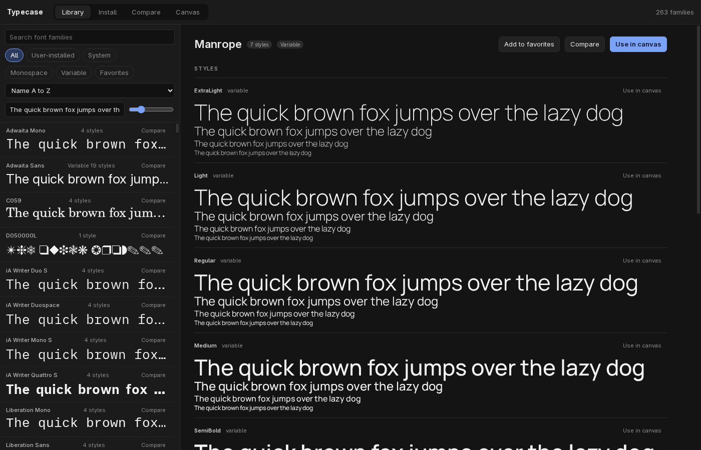
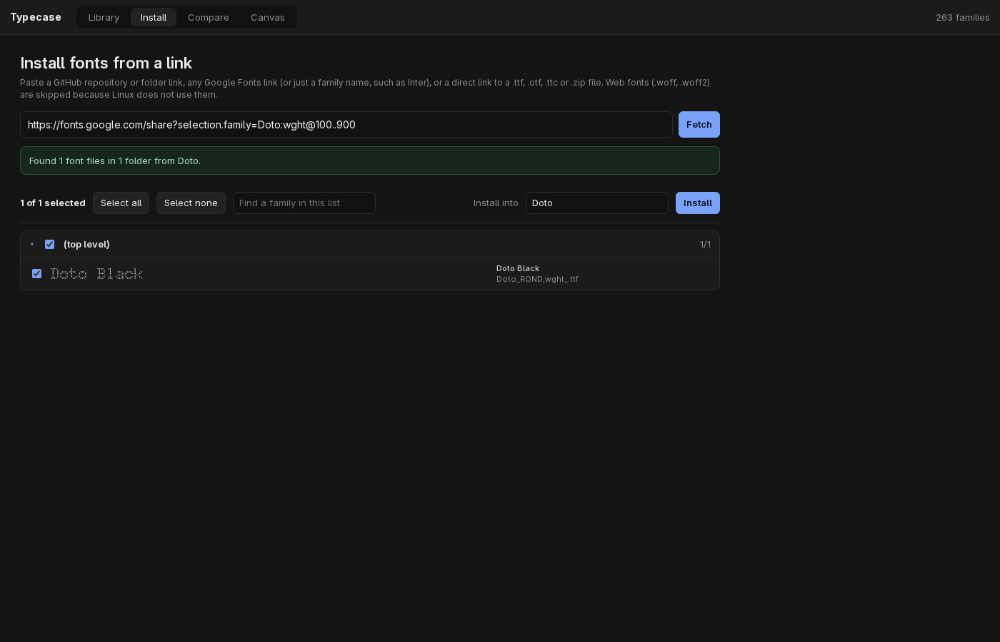
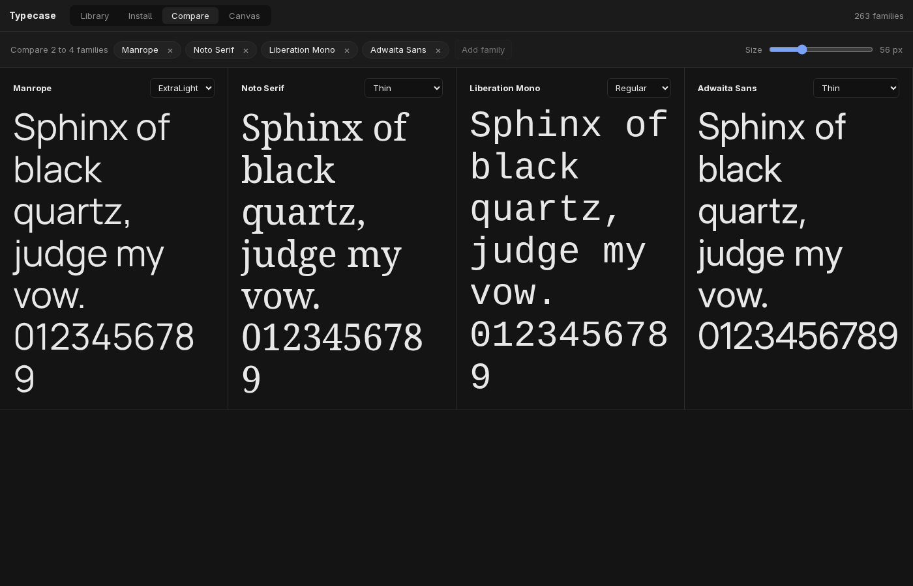
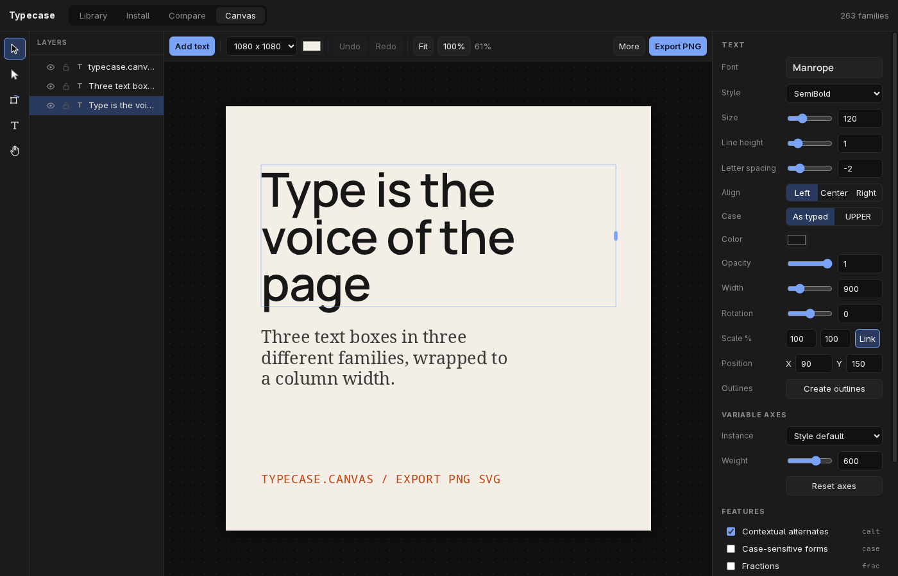
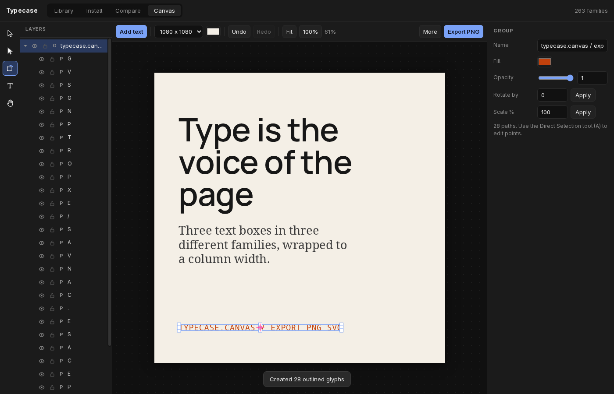

# Typecase

A small font manager and typesetting canvas for [Omarchy](https://omarchy.org) and other Linux desktops. It runs as its own window.



## What it does

### Library
Browse every font on the computer, each name drawn in its own font. Search, filter (user-installed, system, monospace, variable, favorites), sort, and set your own preview text and size. Open a family to see every style, a glyph grid, the file paths and the variable axes.

### Install
Paste a link. Typecase shows a preview before it installs anything.

- GitHub repository, folder or single-file links
- Any Google Fonts link (specimen, share, selection or CSS links), or just a family name such as `Inter`
- Direct `.ttf`, `.otf`, `.ttc` or `.zip` links

Pick folders or files, see a warning for names that already exist, then install. Fonts go to `~/.local/share/fonts/Typecase/<collection>/`. Typecase can uninstall only what it installed. Web fonts (`.woff`, `.woff2`) are skipped because Linux does not use them.



### Compare
Put 2 to 4 families side by side with one shared sample text and size.



### Canvas
A page with layers for basic typesetting.

- **Tools:** Selection (V), Direct Selection (A), Transform (E or R), Text (T), Hand (H, or hold Space).
- **Text:** font, style, size, line height, letter spacing, alignment, case, color. The inspector lists only the OpenType features and variable axes that the font has.
- **Layers:** select, reorder, rename, hide and lock. Alt+drag drags out a copy.
- **Transform:** drag a handle to scale (Shift keeps proportions, Alt scales from the origin). Drag outside the box to rotate (Shift snaps to 15°). Click to move the origin.
- **Create outlines** (Ctrl+Shift+O): turns text into glyph paths with the same line breaks, spacing, features and axes. Direct Selection then edits single glyphs, anchor points and handles.
- **View:** Ctrl+scroll zooms toward the pointer. Scroll or the Hand tool moves the view.
- Export PNG or SVG, and save or open documents. The canvas is saved automatically.





## Install

```
git clone https://github.com/iretonsean/typecase.git
cd typecase
./install.sh
```

Then open **Typecase** from the app menu, or run `typecase`.

Typecase needs only `python3`, `chromium` and `fontconfig`. It installs nothing else.

## Shortcuts on the canvas

| Keys | Action |
|---|---|
| V, A, E, T, H | Selection, Direct Selection, Transform, Text, Hand |
| Space (hold) | Hand tool for a moment |
| Esc | Back to Selection |
| Ctrl+scroll | Zoom toward the pointer |
| Ctrl+Z, Ctrl+Shift+Z | Undo, redo |
| Ctrl+D | Duplicate |
| Delete | Delete |
| Ctrl+] and Ctrl+[ | Forward, backward (add Shift for front, back) |
| Ctrl+Shift+O | Create outlines |
| Arrow keys | Nudge 1 px (Shift: 10 px) |

## Notes

- The app is a small local Python server (standard library only) and one page, opened as a Chromium app window. The server listens only on `127.0.0.1` and refuses requests from other web pages.
- Your data is in `~/.local/share/typecase/`.
- Outlines use HarfBuzz compiled to WebAssembly ([harfbuzzjs](https://github.com/harfbuzz/harfbuzzjs), MIT licence), included in `static/vendor/harfbuzz/`. Nothing is loaded from the internet at run time.

## Tests

- `python3 -m unittest -v` runs the unit tests.
- `tests/e2e-drive.mjs` drives the UI through the Chrome DevTools Protocol. It needs a headless Chromium with `--remote-debugging-port=9333` and a test server on port 47312 (`python3 typecase.py 47312`, with `TYPECASE_STATE` and `TYPECASE_FONT_DIR` pointed at a test folder).
